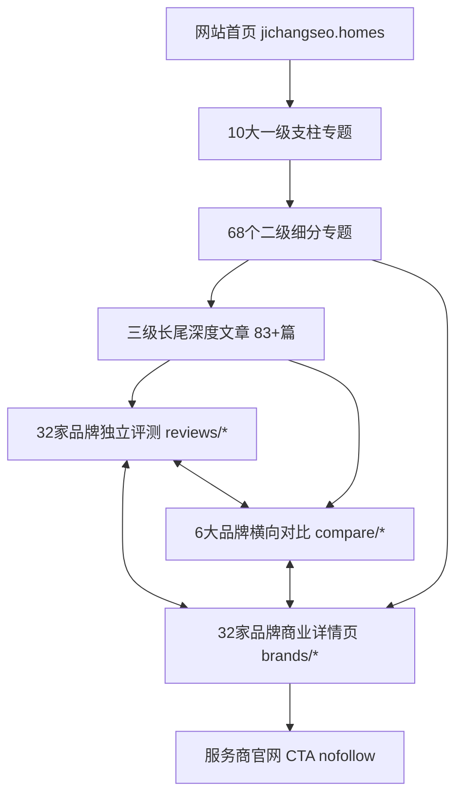

# 三级文章与商业页面内链矩阵拓扑报告

## 一、内链拓扑层级网络

全站通过严密的树状与网状交织结构，确保权重从首页与核心支柱顺畅传递至长尾文章与商业页，杜绝任何死链与孤岛页面：

---

## 二、权重流动与锚文本规范

1. **上行与平级链接（面包屑与专题导航）**：
   - 任何三级文章顶部均可通过面包屑无障碍回退至对应的二级专题与一级支柱。
2. **场景关联下行链接（教程与排错页中的自然引用）**：
   - 教程与排错文章在提及节点需求时，以“低延迟节点推荐”、“防止封号专用线路”等上下文自然锚文本链接至 `/reviews/guangsu`、`/reviews/weifeng` 或 `/compare/*`。
3. **商业详情与独立评测的双向绑定**：
   - 每一篇 `/reviews/{slug}` 在文首与文末均显眼放置“查看 {品牌} 套餐价格与优惠码 -> `/brands/{slug}`”；
   - 每一篇 `/brands/{slug}` 均包含“阅读 {品牌} 完整测速与解锁评测报告 -> `/reviews/{slug}`”。
4. **推广链接合规性隔离**：
   - 所有跳出站外的商业注册 CTA 均强制添加 `rel="nofollow sponsored noopener"` 属性，确保符合 Google 站长指南。
