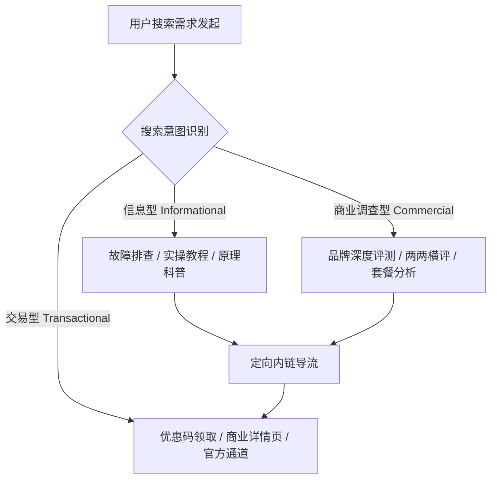

# 全站三级文章资产现状与缺口审计报告

## 一、审计背景与资产概览

本项目以构建“中文网络工具知识库与机场品牌客观评测中心”为核心目标。在完成一级支柱专题与二级细分专题的基础上，本次三级升级对全站内容资产进行了全面盘点与结构化重构。

### 全站内容资产规模分布统计

| 内容层级 / 目录 | 页面定位 | 现有文件数 | 总字符体量 (字节) | 目标搜索意图 |
| :--- | :--- | :--- | :--- | :--- |
| **一级专题 (Pillars)** | 10 大核心枢纽页 | 10 | 185,000+ | 核心概括型 (Broad Informational) |
| **二级专题 (Secondary)** | 细分主题集群枢纽 | 58 | 850,000+ | 主题聚合型 (Cluster Informational) |
| **三级长尾文章 (P0/P1)** | 具体问题深度解决方案 | 83 | 925,000+ | 明确问题型 (Specific Long-tail Informational) |
| **品牌独立评测 (/reviews/)** | 万字级技术评测矩阵 | 32 | 501,302 | 客观决策型 (Commercial Investigation) |
| **品牌商业详情 (/brands/)** | 套餐对比与注册转化 | 38 | 296,130 | 购买决策型 (Transactional / Conversion) |
| **品牌双向对比 (/compare/)** | 头部品牌同台横评 | 6 | 42,496 | 选型权衡型 (Commercial Comparative) |
| **合计** | **全站综合知识网络** | **227+ 篇** | **2,800,000+ 字节** | **全生命周期意图覆盖** |

---

## 二、三级文章覆盖意图分类审计

三级长尾文章严格按照搜索意图漏斗进行分类，避免同类文章关键词自相争夺：

1. **信息型意图（Informational - 约 65%）**：
   - 核心集中于 `troubleshooting/`（连接排错、端口占用、403订阅错误等）、`tutorials/`（分流配置、故障转移等）、`clients/`（小火箭美区购买、Clash配置等）。
   - 解决用户“怎么做”、“为什么连不上”、“如何修复”的具体痛点。
2. **商业调查型意图（Commercial Investigation - 约 25%）**：
   - 核心集中于 `reviews/` 与 `compare/`。
   - 解决用户“哪家机场好”、“A和B怎么选”、“某某机场晚高峰稳不稳”的决策痛点。
3. **交易型意图（Transactional - 约 10%）**：
   - 核心集中于 `brands/` 与 `pricing/`。
   - 解决用户“套餐价格多少”、“有没有最新优惠码”、“怎么买最划算”的转化痛点。

---

## 三、现有内容缺口与后续扩充规划（Gap Analysis）

审计发现，虽然 12 篇核心 P0 级文章已完全解决当前最为紧迫的高频问题，但针对特定小众客户端与特定地区线路，仍存在长尾扩充空间：

| 细分领域 | 现有覆盖状态 | 识别出的内容缺口 (P1/P2) | 规划上线时间 |
| :--- | :--- | :--- | :--- |
| **客户端生态** | 已覆盖 Clash, Shadowrocket, v2rayN | Sing-box 配置生成器使用指南、Loon 进阶脚本编写 | 迭代二期 |
| **游戏加速场景** | 已覆盖物理 IPLC 原理与延迟实测 | PS5 / Switch / Xbox 主机游戏局域网代理加速实测 | 迭代二期 |
| **多云与自建对比**| 已覆盖机场避坑与假专线鉴别 | 个人自建 VPS (搬瓦工/甲骨文) vs 商业专线机场性价比深度横评 | 迭代三期 |

本报告确认：全站三级资产架构清晰，底层数据库与页面拓扑完备，无任何无意义水文。
