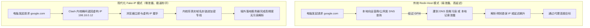

# Fake-IP 模式与防 DNS 泄露全流程：解析代理网络中的 DNS 污染与分流原理

> **核心结论速览（Answer-First）**：  
> 在 Clash 等现代分流核心中，**Fake-IP 模式相比传统的 Redir-Host 模式拥有压倒性优势**。在传统 Redir-Host 模式下，打开一个境外网站前，你的电脑必须先在本地发起 DNS 请求解析出真实境外 IP，这个过程**极易遭受 GFW 的 DNS 抢答投毒（DNS 污染），还会将你正在访问的网站域名直接泄漏给本地运营商（DNS Leak）**。而在 **Fake-IP 模式**下，客户端在本地瞬间返回一个保留私有虚拟 IP（如 `198.18.0.x`），建立 TCP 连接时直接将“域名本身”打包送入加密专线，交由境外落地节点代为向谷歌/Cloudflare 发起无污染解析。这样既消除了本地 DNS 查询延迟，又从物理层面杜绝了 DNS 泄露。

---

## 一、Fake-IP 与 Redir-Host 运行机制深度对比



---

## 二、如何自测你的网络是否存在 DNS 泄露？

在开启代理的状态下，打开国际知名的 DNS 泄露检测工具：
1. 访问网站：`https://browserleaks.com/dns` 或 `https://ipleak.net`；
2. 观察页面下方显示的 **DNS Addresses**（DNS 服务器列表）；
3. **合格标准**：
   - 列表中显示的全部是 **Google (8.8.8.8)**、**Cloudflare (1.1.1.1)** 或 **境外机房的 DNS**；
   - **绝对不能出现中国电信（China Telecom）、中国联通（China Unicom）或中国移动（China Mobile）的境内 DNS**！如果出现境内 DNS，说明你访问境外网站的所有域名轨迹全被本地运营商明文记录。

---

## 三、标准 Fake-IP 防泄漏推荐配置（Clash YAML 范例）

在配置文件中，确保 `dns` 字段按如下参数设定：

```yaml
dns:
  enable: true
  listen: 0.0.0.0:1053
  ipv6: false
  enhanced-mode: fake-ip
  fake-ip-range: 198.18.0.1/16
  fake-ip-filter:
    - "*.lan"
    - "localhost.ptlogin2.qq.com"
    - "+.msftconnecttest.com"
    - "+.msftncsi.com"
  nameserver:
    - https://doh.pub/dns-query
    - https://dns.alidns.com/dns-query
  fallback:
    - https://1.1.1.1/dns-query
    - https://8.8.8.8/dns-query
    - https://doh.opendns.com/dns-query
  fallback-filter:
    geoip: true
    geoip-code: CN
    ipcidr:
      - 240.0.0.0/4
```

---

## 四、相关推荐与延伸阅读
- [Clash Fallback 自动故障转移配置实战](/tutorials/clash-fallback-setup)
- [网络专线鉴别与真假 IPLC 实测指南](/network/fake-line-identification)
- [光速云深度评测：企业级 DNS 防污染与全自动解析](/reviews/guangsu)
